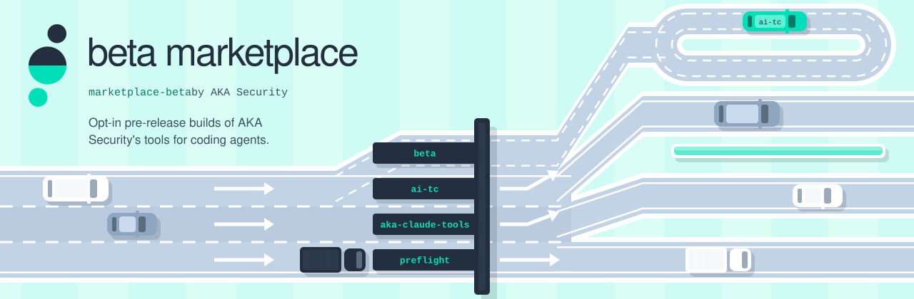

<picture>
  <source media="(prefers-color-scheme: dark)" srcset="assets/cover-dark.svg">
  
</picture>

<p align="center">
  <a href="#whats-in-it-now"><b>What's in it now</b></a> &nbsp;·&nbsp;
  <a href="#try-it"><b>Try it</b></a> &nbsp;·&nbsp;
  <a href="#reporting-problems"><b>Reporting problems</b></a>
</p>

<h3 align="center">Opt-in pre-release builds of AKA Security's tools for coding agents.</h3>


Pre-release builds of **ai-tc** (AI Traffic Control) for Claude Code, for people who want to try them before they ship. Nothing here reaches anyone who didn't add this marketplace: managed fleets and the stable [`akasecurity/marketplace`](https://github.com/akasecurity/marketplace) are unaffected.

## What's in it now

| Plugin | Version | What's new |
|---|---|---|
| `ai-tc@akasecurity-beta` | `0.9.18` | On Claude Code, prompts that need redacting are rewritten in place instead of blocked, and you see your own values on screen while the model keeps vault pointers. |

The entry pins an exact npm version of `@akasecurity/ai-tc-claude-code` and records its `sha512` integrity, the same way the stable marketplace does.

## Try it

Turn off the stable plugin first, so the two don't both run:

```
/plugin disable ai-tc@akasecurity
/plugin marketplace add akasecurity/marketplace-beta
/plugin install ai-tc@akasecurity-beta
```

To go back:

```
/plugin uninstall ai-tc@akasecurity-beta
/plugin enable ai-tc@akasecurity
```

The matching CLI beta installs with `npm install -g @akasecurity/cli@beta`, or `aka update --channel beta`.

## Reporting problems

Open an issue on [`akasecurity/ai-tc`](https://github.com/akasecurity/ai-tc/issues) and say which beta version you were on.
